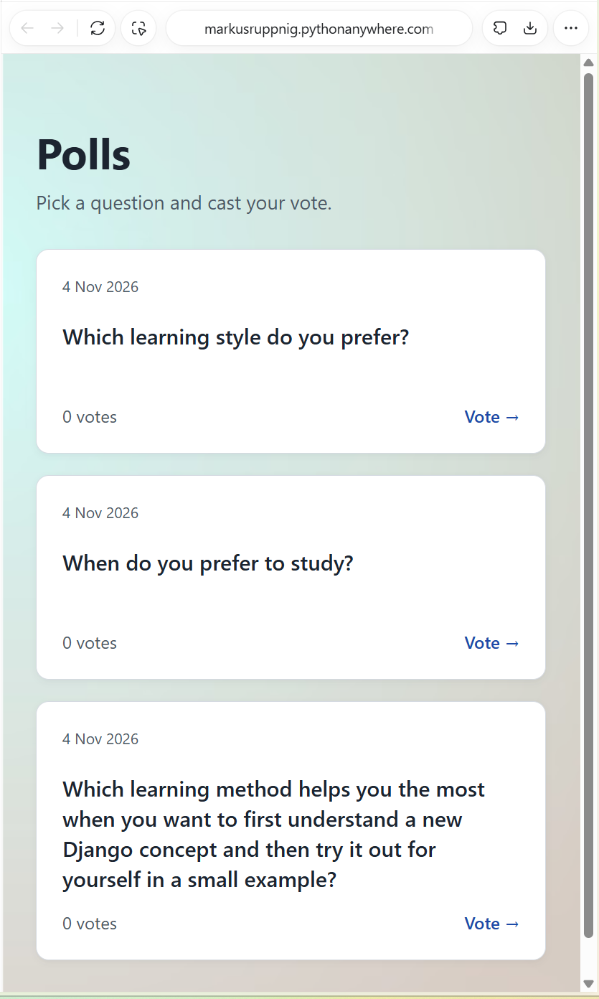
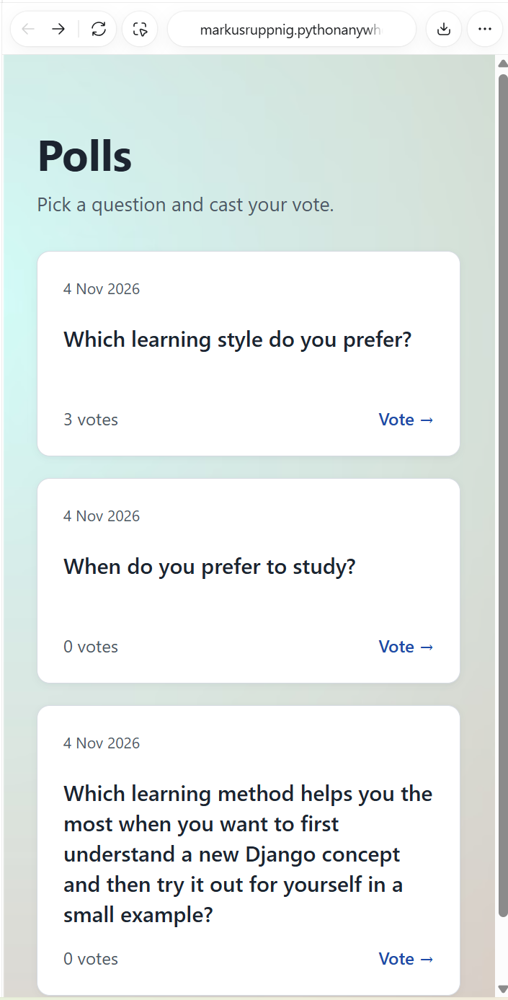

# Schritt 6 – Öffentliche Bereitstellung und Abschlussprüfung

**Datum:** 6. November 2026

**Team:** Valeria und Markus
**Status:** Kachelfunktion öffentlich bereitgestellt und durch Markus erfolgreich geprüft. Dieser Bericht ist vor seinem eigenen GitHub-Upload erstellt.

## Ergebnis und Links

- [Öffentliche Polls-Anwendung](https://markusruppnig.pythonanywhere.com/polls/)
- [Gemeinsames Repository](https://github.com/joseluisrg/polls-alpha)
- [Backend: PR 1](https://github.com/joseluisrg/polls-alpha/pull/1)
- [UI: PR 3](https://github.com/joseluisrg/polls-alpha/pull/3)
- [Lokale integrierte Prüfung: PR 4](https://github.com/joseluisrg/polls-alpha/pull/4)
- [CSS-URL-Fix: PR 5](https://github.com/joseluisrg/polls-alpha/pull/5), [Fix-Commit 4745616](https://github.com/joseluisrg/polls-alpha/commit/47456162f1e9db181ba9fcc94a24ce7bc20330f6)

Die Übersicht zeigt Fragen als Kacheln mit Fragetext, Veröffentlichungsdatum, summierter Stimmenzahl und Link zum vorhandenen Abstimmungsformular. Das optionale „New“-Kennzeichen gehört nicht zum umgesetzten Umfang.

## Zusammenarbeit und tatsächliche Ausführung

- **Valeria:** Template und CSS der Kachelansicht; eigene Entwicklungsumgebung und Testfragen; Teamreviews gemäß den dokumentierten Pull Requests.
- **Markus:** Gesamtstimmenberechnung und Tests mit KI-Unterstützung; lokale Integration und manuelle Prüfungen; Git-/GitHub-Aktionen seiner Arbeitsschritte; Bereitstellung und Prüfung auf seinem PythonAnywhere-Konto.
- **Codex:** Unterstützung bei Planung, Code und Prüfungen, Auswertung der von Markus übermittelten Ausgaben und Screenshots, Erstellung von Dokumentation und Befehlsanleitungen. Die hier berichteten Django-Testläufe und öffentlichen Bedienprüfungen hat Markus ausgeführt.
- **Ausnahme im Reviewablauf:** PR 5 wurde durch Markus ohne Valerias Review gemerged, weil sie nicht verfügbar war. Dafür wird keine Peer-Freigabe behauptet.

## Gemessene Umgebungen und automatisierte Prüfungen

| Prüfung durch Markus | Python | Django | Ergebnis |
|---|---|---|---|
| Lokale integrierte Kachelansicht | 3.14.10 | 5.2.18 | 15 Tests, 0,069 s, OK |
| Lokaler CSS-URL-Fix | 3.14.10 | 5.2.18 | 15 Tests, 0,062 s, OK |
| PythonAnywhere vor CSS-URL-Fix | 3.13.1 | 5.2.18 | 15 Tests, 0,145 s, OK |
| PythonAnywhere nach CSS-URL-Fix | 3.13.1 | 5.2.18 | 15 Tests, 0,134 s, OK |

Alle übermittelten Testläufe meldeten eine Systemprüfung ohne Befunde. Die Hostingprüfung unter Python 3.13.1 ist ausdrücklich von der lokalen Prüfung unter Python 3.14.10 getrennt.

## Bereitstellung und Hindernis

1. Featurestand von `origin/main` in den bestehenden Hostingbranch `chore/pythonanywhere-setup` übernommen; erster Hosting-Merge `f6247fb`.
2. Vorhandene Hostingkonfiguration erhalten: `settings.py` und `requirements.txt` gegenüber Setup-Commit `9ed99e4` unverändert geprüft.
3. Statische Dateien mit `collectstatic --noinput` gesammelt: eine Datei kopiert, 159 unverändert. Vergleich der Projekt-CSS mit der gesammelten Datei erfolgreich; Web-App neu geladen.
4. Öffentlich zunächst weiterhin alte Formatierung beobachtet. Projektdatei, gesammelte Datei und direkt abgerufene öffentliche CSS-Antwort waren identisch: jeweils 1268 Bytes, mit den neuen Regeln `.page` und `.tiles`. Die genaue Ursache beziehungsweise Cache-Schicht blieb unbestimmt.
5. Stylesheet-Link im Template um `?v=poll-tiles-1` ergänzt, lokal getestet und über PR 5 integriert.
6. Aktuellen Teamstand einschließlich Fix in den Hostingbranch übernommen: Hosting-Merge `0b07bc2`; Team-Merge auf `origin/main` zuletzt `fd3ed37`. Hostingkonfiguration weiterhin erhalten, CSS-Vergleich erfolgreich, 15 Tests erfolgreich; nach Reload neue öffentliche Formatierung bestätigt.

Die genannten Hosting-Merges sind Nachweise aus Markus' PythonAnywhere-Konsole. Ihre Veröffentlichung als GitHub-Commits wird nicht behauptet.

Das Web-Tab-Mapping `/static/` zeigte auf das konfigurierte `STATIC_ROOT`. Es war keine Änderung des Mappings erforderlich. Die Versionskennung änderte den Stylesheet-Link; die CSS-Datei selbst blieb bei diesem Fix unverändert.

Fachlicher Hintergrund: [PythonAnywhere – Django Static Files](https://help.pythonanywhere.com/pages/DjangoStaticFiles/), [Django 5.2 – collectstatic](https://docs.djangoproject.com/en/5.2/ref/contrib/staticfiles/#collectstatic), [HTTP-Caching – Cache-Schlüssel](https://www.rfc-editor.org/rfc/rfc9111.html#section-2).

## Öffentliche Testdaten und Bedienprüfung

Markus hat drei eigene Testfragen in seiner Hostingdatenbank angelegt. Die lokale Datenbank wurde dafür nicht hochgeladen. Der öffentliche Screenshot zeigt bei allen drei Fragen das Veröffentlichungsdatum **4 Nov 2026**.

| Frage | Ausgangsstand | Abschlussstand |
|---|---:|---:|
| Which learning style do you prefer? | 0 | 3 |
| When do you prefer to study? | 0 | 0 |
| Lange Frage zum Lernen eines neuen Django-Konzepts | 0 | 0 |

Markus bestätigte alle angeleiteten öffentlichen Prüfungen als erfolgreich und erklärte die drei Stimmen durch dreimalige Betätigung bei der Testabstimmung. Der dokumentierte Vergleich lautet somit **0, 0, 0 → 3, 0, 0**.

- Abstimmung und Ergebnisansicht funktionieren; Übersicht zeigt danach die aktualisierte Gesamtstimmenzahl.
- Alle drei Kachellinks führen zur jeweils richtigen Frage.
- In der schmalen Ansicht bleiben die Kacheln und der lange Fragetext lesbar.
- Linkfokus mit Tab sichtbar; Öffnen mit Enter funktioniert.

Die Screenshots belegen den sichtbaren Zustand. Die Link-, Ergebnis- und Tastaturprüfung ist zusätzlich durch Markus' Rückmeldung belegt.

### Screenshot vor den Testabstimmungen

6. November 2026: Drei öffentliche Kacheln mit Datum und je 0 Stimmen; vollständiger langer Fragetext in einspaltiger Darstellung.

### Screenshot nach den Testabstimmungen

6. November 2026: Erste Frage mit 3 Stimmen, andere Fragen weiterhin mit 0 Stimmen. Die schmale Adresszeile zeigt die Domain nur teilweise; die vollständige Live-Adresse steht oben im Bericht. Beide Bilder wurden unverändert gesichert.

## Kurzprotokoll für den Labor-Bericht

- **Gemacht:** Kachelfunktion auf PythonAnywhere bereitgestellt; Hostingkonfiguration erhalten; CSS-Darstellung nach Diagnose und URL-Fix korrigiert; 15 Hostingtests erfolgreich; drei Hosting-Testfragen angelegt; öffentliche Abstimmung, Links, schmale Ansicht und Tastaturbedienung erfolgreich geprüft; Abschlussstand 3, 0 und 0 Stimmen.
- **KI genutzt:** Anleitungen und kleine Codeänderung vorbereitet; Konsolenausgaben und Screenshots ausgewertet; tatsächliche Ergebnisse, Umgebungsunterschiede und Review-Ausnahme dokumentiert. Git-/GitHub-Aktionen und Bedienprüfungen selbst ausgeführt.
- **Gelernt – persönlicher Formulierungsvorschlag:** Gemeinsamer Code und getrennte Datenbanken unterscheiden; Bereitstellung von Code, statischen Dateien und Testdaten getrennt prüfen; erfolgreiche Tests durch öffentliche Bedienprüfungen ergänzen; Diagnosebelege und tatsächliche Teamreviews nachvollziehbar festhalten.
- **GitHub-Link zur Neuerung:** [CSS-URL-Fix 4745616](https://github.com/joseluisrg/polls-alpha/commit/47456162f1e9db181ba9fcc94a24ce7bc20330f6), [PR 5](https://github.com/joseluisrg/polls-alpha/pull/5). Commit-Link dieses Abschlussberichts bis zum Upload ausstehend; danach im Labor-Bericht ergänzen.

## Noch offen für die Abgabe

- Diesen Bericht und seine zwei Screenshots durch Markus auf GitHub speichern; tatsächlichen Commit-/PR-Link im Labor-Bericht ergänzen.
- Labor-Bericht mit Projektplan, Rollen, Teamabläufen, KI-Einsatz und persönlichen Lernergebnissen beider Personen vervollständigen.
- Screenshots der tatsächlichen Yellowdig-Beiträge sowie der GitHub-Seiten „Contributors“ und „Code Frequency“ ergänzen.
- Repository- und Live-Link im endgültigen Labor-Bericht prüfen. Abgabe: Montagabend, 9. November 2026.

Der Funktionsumfang ist geprüft. Die vollständige Abgabedokumentation ist damit noch nicht als erledigt erklärt.
